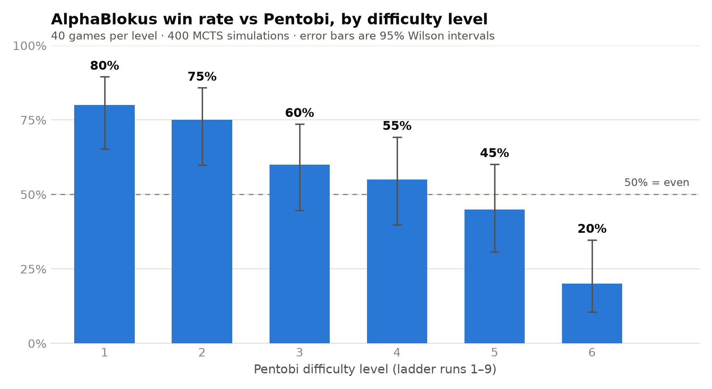

# AlphaBlokus

[](https://github.com/HenryTBCassidy/AlphaBlokus/actions/workflows/ci.yml)

An AlphaZero implementation for Blokus Duo, written from scratch. It learns the game by playing against itself, using Monte Carlo Tree Search (MCTS) guided by a ResNet with a policy head and a value head. Training is in PyTorch and self-play runs on the GPU in JAX.

There are no human games and no hand-written strategy in it. Blokus Duo is a two-player game on a 14×14 board where each player has 21 polyomino pieces, which gives 17,837 possible moves. I benchmark against [Pentobi](https://pentobi.sourceforge.io/), the strongest open-source Blokus engine (MCTS with RAVE). The goal is to beat it on its hardest setting, level 9.

The current best network is [published](https://github.com/HenryTBCassidy/AlphaBlokus/releases/tag/v3-gen40), so you can download it and play it or benchmark it yourself ([how](#play-against-it)).

## Status (October 2026)

The best network beats Pentobi comfortably at levels 1 and 2, has a winning record up to level 4 and loses from level 6 up. Against level 9, with the same thinking time per move and Pentobi's opening book on, it scores 31.5%. Once you correct for how much moving first matters in Blokus Duo, that is about 375 Elo short.

Training plateaued around level 4, so in August I stopped running bigger experiments and worked out why. What I found:

- It isn't network size. A much bigger network did no better.
- Three of my measurements were wrong. The held-out evaluation set had leaked into the training data, the arena that decided whether a new network replaced the old one was mostly measuring which colour moved first, and Pentobi's opening book had never been loaded.
- The value head, the part of the network that estimates who is winning, mostly guesses from whose turn it is rather than reading the board.

The next step is a training run from the best checkpoint with all of those fixes in, which hasn't been done yet. [`docs/plans/ROADMAP.md`](docs/plans/ROADMAP.md) has what's currently in progress.

## Results against Pentobi

<picture>
  <source media="(prefers-color-scheme: dark)" srcset="docs/assets/pentobi-ladder-dark.png">
  
</picture>

| Pentobi level | W–L–D | Win rate | 95% CI |
|---|---|---|---|
| 1 | 32–8–0 | 80% | [65, 90] |
| 2 | 30–9–1 | 75% | [60, 86] |
| 3 | 24–14–2 | 60% | [45, 74] |
| 4 | 22–17–1 | 55% | [40, 69] |
| 5 | 18–22–0 | 45% | [31, 60] |
| 6 | 8–30–2 | 20% | [10, 35] |

These are 40 games per level at 400 MCTS simulations per move, with the best checkpoint at the time: a 192-filter × 12-block ResNet (about 8M parameters) after roughly 70 generations and 700k self-play games, run through my [Pentobi GTP harness](docs/05-EVALUATION.md). Pentobi's opening book was off for these games because, as it turned out, it had never been loaded.

For level 9 I gave both sides the same time per move, which works out at 4,096 simulations for my network, and turned Pentobi's opening book on. 100 games, half as each colour ([how the comparison is set up](docs/10-EVALUATION-SPEC.md)):

| vs Pentobi level 9 | W–L–D | Score | 95% CI |
|---|---|---|---|
| Moving first | 30–17–3 | 0.63 | [0.49, 0.75] |
| Moving second | 0–50–0 | 0.00 | [0.00, 0.07] |
| Total | 30–67–3 | 0.315 | [0.23, 0.41] |

Losing all 50 games as second mover looked like a bug, but it isn't: the same code scores 0.65 as second mover against level 1. Moving first is a huge advantage at this level. When Pentobi level 9 plays itself, whoever moves first scores about 0.93, so a network around 375 Elo weaker should expect to win almost nothing as second mover.

Pentobi's levels are fixed simulation counts and the gaps between them aren't even (level 6 to 7 is a 30× jump). I measured level 9 at about 156 Elo above level 7.

## How it works

Each generation:

1. Self-play. The current network plays thousands of games against itself, using MCTS to pick moves. The search's visit counts and the final results become the training data.
2. Train. The network learns to predict the search's move probabilities (policy head, KL loss) and the result of the game (value head, MSE loss).
3. Evaluate. Originally a new network had to beat the old one in an arena to be kept. In Blokus Duo that mostly measured who moved first, so the latest config keeps every generation and picks the best checkpoint by playing Pentobi. I also run a pooled [BayesElo tournament](docs/research/pool-elo-methodology.md) across checkpoints at the end of a run.

I got the framework working on Tic-Tac-Toe first, where it reaches near-perfect play against a minimax player within a couple of generations, then plugged Blokus in. The algorithms are written up in [`docs/02-ALGORITHMS.md`](docs/02-ALGORITHMS.md) and the network in [`docs/03-NEURAL-NETWORKS.md`](docs/03-NEURAL-NETWORKS.md).

## Engineering

Most of the work in an AlphaZero project is making self-play cheap enough, and the evaluation reliable enough, to iterate. The main pieces:

- JAX self-play ([`games/blokusduo/jax/`](src/alphablokus/games/blokusduo/jax/)). I rewrote the rules as batched int8 matrix multiplies so thousands of games run on the GPU at once, searched with DeepMind's [mctx](https://github.com/google-deepmind/mctx) using [Gumbel AlphaZero](https://openreview.net/forum?id=bERaNdoegnO) over the top 64 candidate moves. The network is copied across from the PyTorch checkpoint each generation. At the production network size it is about 12× faster than the python engine, plays at the same strength in an A/B test, and CI checks it matches the python rules exactly ([write-up](docs/research/jax-pipeline-ab.md)).
- Speeding up the python engine about 14×. Multiprocess workers (5.7× on 8 workers), Pentobi-style precomputed move generation tables (9× per call), batched MCTS leaf evaluation with virtual loss, and a fully convolutional policy head with 21.6× fewer parameters. Each step was profiled and recorded ([tracker](docs/plans/archive/full-cycle-optimisation.md)). I also built a cross-worker inference server, but once the network got smaller it didn't help, so I left it out.
- Memory. Boards are stored as 196-byte arrays in a rolling replay buffer and only turned back into 44×14×14 tensors when a batch is built, which uses about 175× less RAM. Policies are stored sparsely on disk; the dense version was 71 KB per position.
- Cloud training on rented RTX 5090s, with Docker, checkpoint sync to S3-compatible storage and `--resume`, so losing a spot GPU costs one generation rather than the whole run.
- Evaluation. A GTP client that drives the real Pentobi binary at all nine levels. The internal evaluation set holds out whole games from training and its confidence intervals are bootstrapped by game, because treating positions as independent gave 95% intervals that covered the true value only 52% of the time in simulation. Every run records its code commit, config and data, and won't start from a config that isn't committed.
- The usual hygiene. An installable `src/` package, strict mypy, ruff in CI, tests that mirror the source tree, and exact parity tests wherever the rules exist twice (python vs JAX, python vs the TypeScript web version).

## Architecture

```
src/alphablokus/
├── interfaces.py       # IBoard / IGame / IPolicyValuePredictor / INeuralNetWrapper protocols
├── registry.py         # Composition root, the only module naming concrete games/backends
├── search/             # MCTS: PUCT, Dirichlet root noise, batched inference + virtual loss
├── selfplay/           # Episode loop + backend dispatch (serial / parallel / JAX)
├── parallel/           # Worker pool for self-play, arena, and Elo games
├── training/           # Coach generation loop, replay buffer, eval set, memory diagnostics
├── evaluation/         # Arena, acceptance gate, Elo, pooled BayesElo tournament
├── storage/            # Parquet metrics + self-play stores, sparse policy codec, W&B mirror
├── reporting/          # Self-contained interactive HTML report (offline SVG charts + arena replay browser)
└── games/
    ├── tictactoe/      # Reference implementation + minimax oracle
    └── blokusduo/      # Board/rules/codecs, move-gen tables, Pentobi GTP, JAX backend, ResNet
```

Framework code only depends on the interfaces, so adding a game means implementing them under `games/<name>/` and registering it in `registry.py`. For Blokus the board is encoded as 44 channels (one plane per piece per player, plus two summary planes), board states are immutable and keyed by a 196-byte placement grid (which gives MCTS transpositions for free), and codecs map the 17,837 actions. Tests in `tests/` mirror the source tree.

## Quickstart

Requires Python 3.11+ and [`uv`](https://docs.astral.sh/uv/).

```bash
git clone https://github.com/HenryTBCassidy/AlphaBlokus.git
cd AlphaBlokus
uv sync --extra dev             # + --extra jax (CPU) or --extra jax-cuda (NVIDIA) for the JAX backend
uv run pytest -m "not slow"     # test suite (drop the marker for integration tests)

# Quick end-to-end pipeline check (CPU, seconds)
uv run alphablokus --config run_configurations/test_run.json

# Tic-Tac-Toe demo (CPU, ~10 min)
uv run alphablokus --config run_configurations/ttt_mac_demo.json

# Small Blokus run (python backend) / production-style run (JAX Gumbel backend, GPU)
uv run alphablokus --config run_configurations/blokus_3gen.json
uv run alphablokus --config run_configurations/blokus_jax_gumbel_30.json
```

Set `"cuda": true/false` in the config's `net_config` to match your machine. Every run writes a self-contained interactive HTML report to `temp/<run_name>/Reporting/report.html`; `--report-only` re-renders it without retraining, `--resume` continues a stopped run. Pentobi benchmarking: `uv run python scripts/pentobi_benchmark.py --sweep` (needs a `pentobi-gtp` binary).

## Play against it

My best network (generation 40 of the `blokus_cloud_v3` run) is attached to a [GitHub release](https://github.com/HenryTBCassidy/AlphaBlokus/releases/tag/v3-gen40). Everything below runs on your own machine; the release only holds the weights. From a clone of the repo:

```bash
uv run python scripts/download_model.py    # ~98 MB, checks the SHA-256
```

That puts the checkpoint where the commands below expect it.

To play in your browser, export the network for the web app and build it (needs Node.js):

```bash
uv run --extra web python scripts/export_web_assets.py \
    --config run_configurations/best_net_v3_gen40.json \
    --checkpoint models/runs/blokus/v3_gen40/Nets/v3_gen40.pth.tar
cd web && npm ci && npm run build && npm run preview
```

This version runs everything in the browser: a TypeScript port of the rules, MCTS, and the network through ONNX Runtime Web (WebGPU, or WebAssembly if WebGPU isn't available). The TypeScript rules replay test games identically to the python engine, and full games are checked move by move across both.

For full strength, run the real PyTorch engine behind the same page instead of `npm run preview`, then open http://127.0.0.1:8000:

```bash
uv run --extra play alphablokus-play \
    --config run_configurations/best_net_v3_gen40.json \
    --checkpoint models/runs/blokus/v3_gen40/Nets/v3_gen40.pth.tar
```

To benchmark it against Pentobi, build `pentobi-gtp` ([instructions](docs/06-INTERFACES.md#building-pentobi)) and run:

```bash
uv run python scripts/pentobi_benchmark.py --config run_configurations/best_net_v3_gen40.json \
    --net v3_gen40.pth.tar --levels 1-6 --games 40 --nobook
```

Set `"cuda": true` in the config if you have an NVIDIA GPU. The difficulty levels in the app are calibrated in [`docs/research/web-play-calibration.md`](docs/research/web-play-calibration.md).

## Documentation

Design docs: [background and why Blokus](docs/01-BACKGROUND.md) · [algorithms](docs/02-ALGORITHMS.md) · [neural networks](docs/03-NEURAL-NETWORKS.md) · [Blokus Duo rules and pieces](docs/04-BLOKUS-DUO.md) · [evaluation and Elo](docs/05-EVALUATION.md) · [Pentobi interface](docs/06-INTERFACES.md) · [data storage](docs/07-DATA-STORAGE.md) · [compute options](docs/09-COMPUTE-OPTIONS.md).

I work from written plans. [`docs/plans/archive/`](docs/plans/archive/) has about 60 finished ones, which together are the history of the project (move generation, batched inference, the JAX pipeline, the replay buffer, memory fixes, cloud training and so on). [`docs/research/`](docs/research/) has the longer investigations, including profiling, A/B tests, the pool Elo method and the [August 2026 plateau investigation](docs/research/investigation-2026-08/). [`docs/plans/ROADMAP.md`](docs/plans/ROADMAP.md) lists what's in progress.

## References

- Silver et al., [Mastering the game of Go without human knowledge](https://www.nature.com/articles/nature24270) (AlphaGo Zero, 2017)
- Silver et al., [A general reinforcement learning algorithm that masters chess, shogi, and Go through self-play](https://www.science.org/doi/10.1126/science.aar6404) (AlphaZero, 2018)
- Danihelka et al., [Policy improvement by planning with Gumbel](https://openreview.net/forum?id=bERaNdoegnO) (2022), the low-simulation search the JAX backend uses
- [mctx](https://github.com/google-deepmind/mctx) (DeepMind), JAX-native MCTS
- [Pentobi](https://pentobi.sourceforge.io/) (Markus Enzenberger), the benchmark opponent, and where the precomputed move-generation design came from
- [alpha-zero-general](https://github.com/suragnair/alpha-zero-general) (Surag Nair), the framework this project started from

## License

[MIT](LICENSE).
